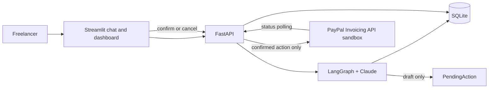

# Architecture

## Overview

InvoicePilot accepts a natural-language request, validates a structured draft, and persists an approval action. A user reviews the invoice in Streamlit and confirms it through FastAPI. Only that confirmation path can create and send the invoice through PayPal's sandbox Invoicing API. SQLite stores drafts, actions, chat history, and invoice status.

## Module boundaries

- `schemas.py` defines the shared contract; database and API code serialize these models.
- `db.py` owns SQLite connections, schema initialization, and repository functions. SQL uses parameters.
- `main.py` owns HTTP endpoints and routes `PendingAction` execution through one service path.
- `paypal_client.py` owns OAuth and the small set of PayPal v2 Invoicing REST operations. The toolkit's Python package currently pins an older LangChain release; use direct REST calls to avoid an incompatible dependency stack and to keep write operations behind explicit server code.
- `agent/` may create pending actions and call read-only invoice/insight tools. It must not receive PayPal write tools.
- `ui/streamlit_app.py` is a thin HTTP client; it does not call PayPal or Claude directly.

## Stack

Python 3.12, FastAPI, Pydantic v2, SQLite, HTTPX, Streamlit, LangGraph, and LangChain Anthropic. The integration uses PayPal's v2 Invoicing REST API in sandbox mode. Dependency versions are constrained in `requirements.txt` and must remain compatible with the verified APIs.

## Security and failure handling

- API credentials come only from environment variables or `.env`; `.env` is ignored by Git.
- Sandbox is the only supported PayPal base URL; production mode is rejected.
- Persist action state before and after external execution. Confirming a non-pending action must not execute it twice.
- Use PayPal request IDs for invoice creation to make retries idempotent.
- Never expose exception traces, secrets, or access tokens in API responses or logs.
- CORS is limited to the local Streamlit origins by default.
- The app is a local hackathon demo and has no user authentication; don't deploy it with real credentials or production access.

## Status mapping

PayPal `DRAFT` maps to local `DRAFT`; sent/unpaid states map to `SENT`; payment-complete states map to `PAID`; cancelled states map to `CANCELLED`. Local `OVERDUE` is derived from a sent invoice whose due date is before the current UTC date. Unknown provider states remain visible as `SENT` with the raw status retained in metadata/logging rather than falsely reported as paid.
